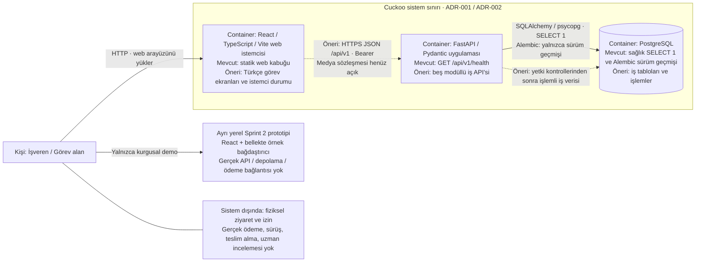

# C4 Container görünümü · inceleme taslağı

Özgür'ün web/API sınırı katkısıdır. Emmanuel mimari kararlardan, Emir çalışma
ortamı ve dağıtım ayrıntılarından sorumludur. Bu görünüm mevcut kararlarını
değiştirmez. [Sprint 1 bağlam diyagramı](../system-context.svg) korunur.
Kesikli çizgiler **önerilen** iş etkileşimidir; düz çizgiler mevcut altyapıdır.

