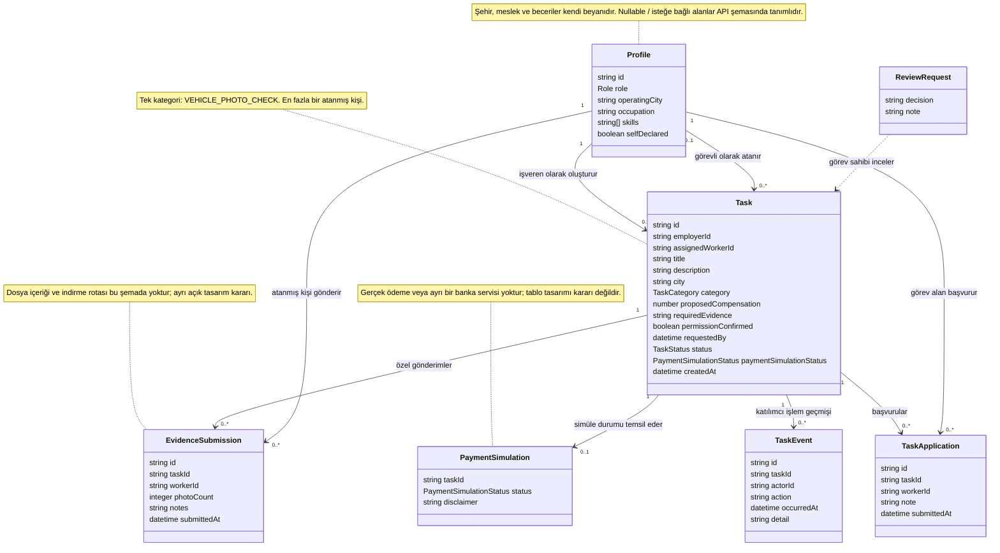

# UML Domain Class · önerilen alan modeli

API 0.2.1-draft şemalarından kavramsal görünüm; ORM veya veritabanı şeması değildir.
Üretimde iş tabloları yoktur; yalnızca sağlık ve Alembic sürüm geçmişi mevcut.
US-01–US-13; FI katkısı, TL/DO incelemesi beklenir.

