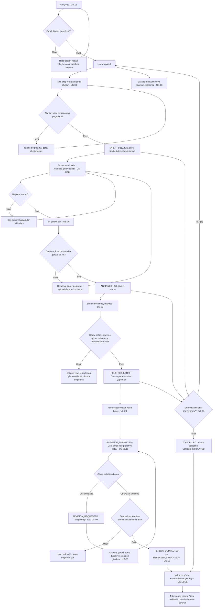

# İşveren kullanıcı akışı · Özgür katkısı

US-01, US-03, US-06–US-13. Türkçe prototip davranışı; üretimde yalnızca sağlık
uç noktası ve web kabuğu çalışır. Gizlilik, iptal ve düzeltme politikalarının
ürün/API onayı beklenir. [Varsayımlar](../../sprint-2-frontend-api-boundary.md).

Figma düğümleri: `O01`, `E01`–`E13`, `O03`, `O04`.
[Ekran kataloğu ve bağlantılar](../../sprint-2-figma-handoff.md).
