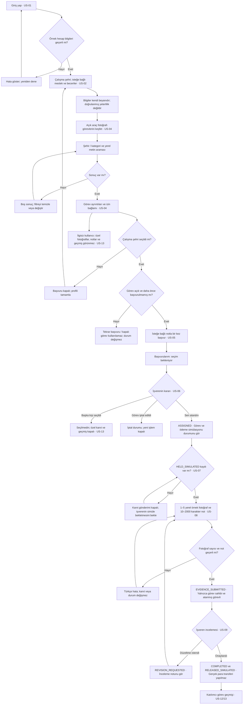

# Görev alan kullanıcı akışı · Özgür katkısı

US-01/02, US-04–US-09, US-12/13. Yerel tasarım demosudur; çalışan üretim
ürünü yalnızca sağlık uç noktası ve web kabuğudur. Aynı görev iki örnek rol
arasında korunur. Şehir eşitliği zorunlu tutulmaz; bu bir ürün kararı değildir.

Figma düğümleri: `O01`, `G01`–`G11`, `O03`, `O04`.
[Ekran kataloğu](../../sprint-2-figma-handoff.md).
