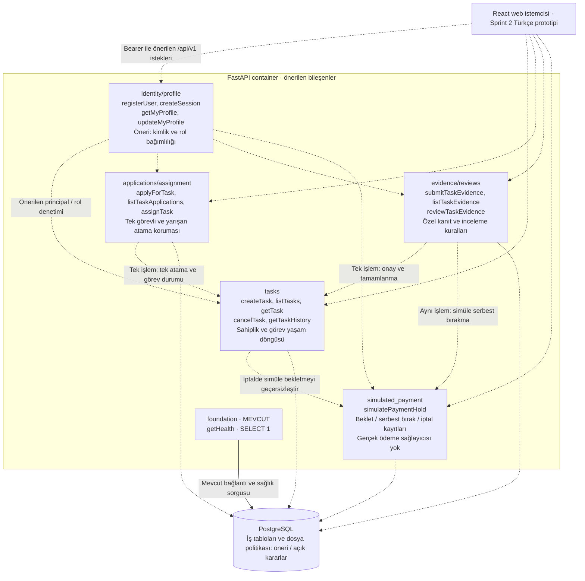

# Önerilen API Component görünümü

Beş iş sınırı tek FastAPI uygulamasında önerilen modüllerdir. Mevcut sağlık
denetimi `foundation` paketini kullanır. Kesikli bağlantılar planlanan iş
etkileşimlerini gösterir. [C4 Container görünümü](c4-container.md)

