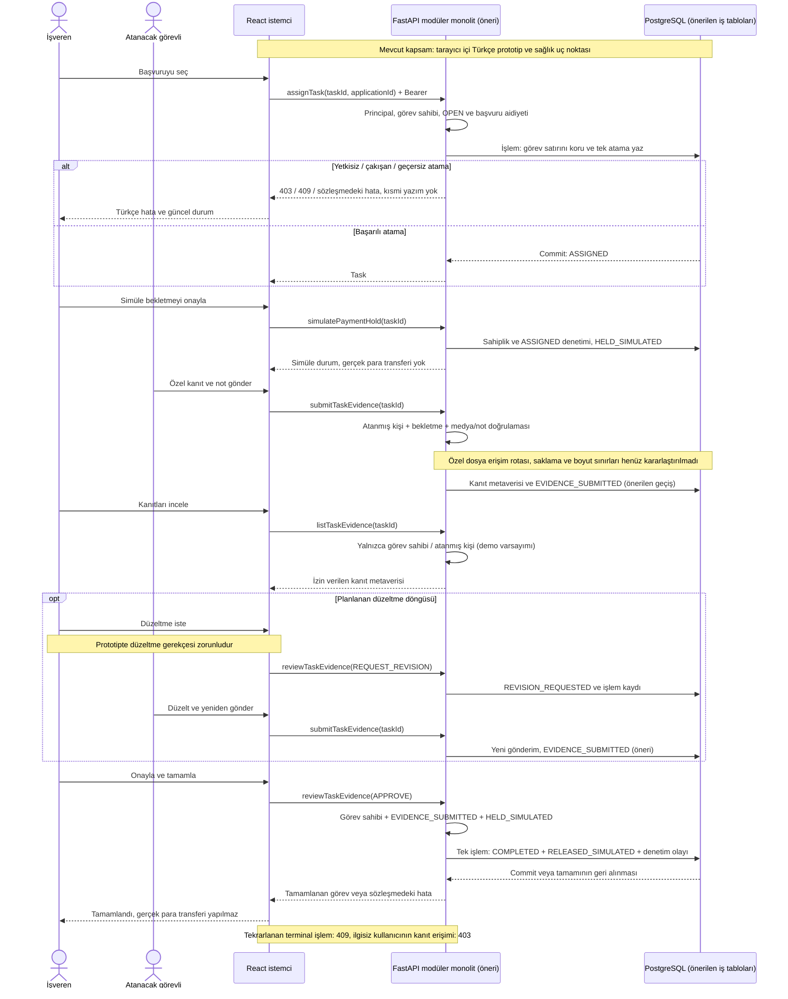

# Atamadan tamamlamaya UML Sequence · öneri

US-06–US-10 ve US-13. Bu görünüm planlanan iş API'si sıralamasını gösterir.
Mevcut Sprint 2 prototipi örnek görev durumunu tarayıcı belleğinde tutar.
İşlemler [API taslağına](../../../api/openapi.yaml) dayanır. Prototipin medya
ve revizyon davranışları [tasarım kurallarında](../../sprint-2-evidence-decisions.md) kayıtlıdır.

