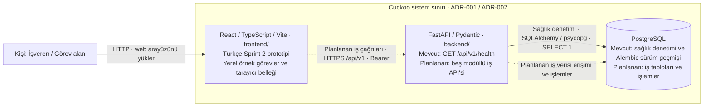

# C4 Container görünümü

**Web/API sınırı katkısı:** Özgür Furuncuoğlu

Sprint 2'nin Türkçe demosu `frontend/` içinde çalışır ve örnek görev
durumunu tarayıcı belleğinde tutar. Düz çizgiler mevcut etkileşimleri,
kesikli çizgiler planlanan iş API'si çağrılarını ve veri erişimini gösterir.
[Sistem bağlamı](../system-context.svg) ·
[Web/API sınırı](../../sprint-2-frontend-api-boundary.md)

