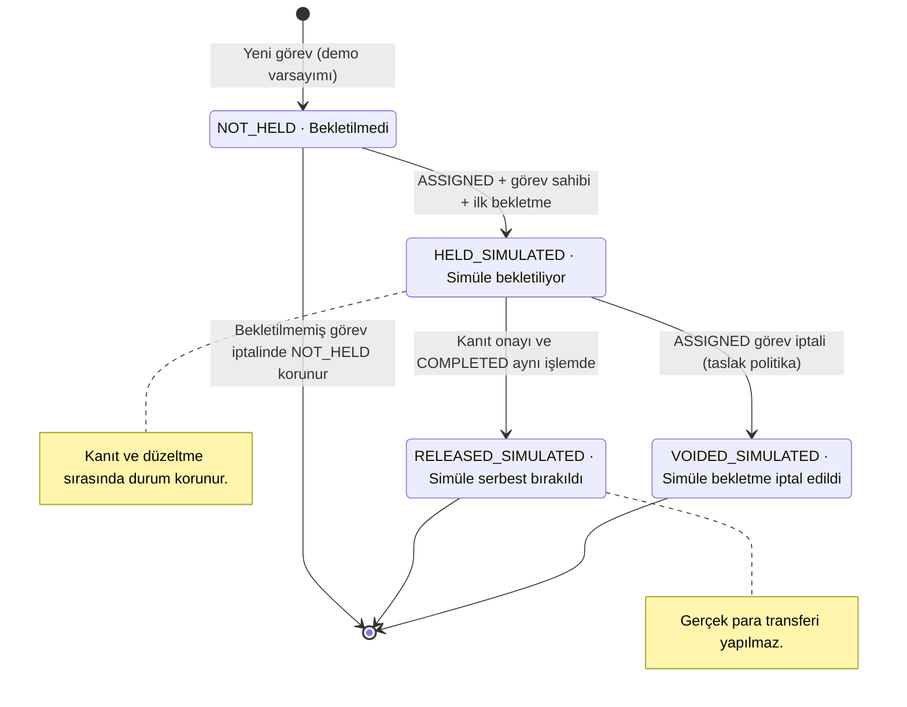

# UML State Machine · görev ve simüle ödeme

**Önerilen iş modeli.** Türkçe Sprint 2 prototipi geçişleri tarayıcı belleğinde
canlandırır. FastAPI uygulaması sağlık uç noktasını sunar. US-03, US-06–US-11.
Ödeme durumu görev durumundan ayrıdır. Onay iki durumu aynı işlemde değiştirir.

```mermaid
stateDiagram-v2
    state "OPEN · Başvuruya açık" as OPEN
    state "ASSIGNED · Görevli atandı" as ASSIGNED
    state "EVIDENCE_SUBMITTED · İnceleme bekliyor" as EVIDENCE_SUBMITTED
    state "REVISION_REQUESTED · Düzeltme istendi" as REVISION_REQUESTED
    state "COMPLETED · Tamamlandı" as COMPLETED
    state "CANCELLED · İptal edildi" as CANCELLED
    [*] --> OPEN: Geçerli görev oluşturma ve izin onayı
    OPEN --> ASSIGNED: Görev sahibi tek bir başvuru seçer
    ASSIGNED --> ASSIGNED: Simüle bekletme kaydı (görev durumu değişmez)
    ASSIGNED --> EVIDENCE_SUBMITTED: Atanmış kişi + bekletme + geçerli kanıt
    EVIDENCE_SUBMITTED --> REVISION_REQUESTED: Görev sahibi düzeltme ister (demo varsayımı)
    REVISION_REQUESTED --> EVIDENCE_SUBMITTED: Atanmış kişi yeniden gönderir (önerilen geçiş)
    EVIDENCE_SUBMITTED --> COMPLETED: Onay ve simüle serbest bırakma tek işlem
    OPEN --> CANCELLED: Görev sahibi iptal eder
    ASSIGNED --> CANCELLED: Görev sahibi iptal eder; varsa simüle bekletme iptal edilir
    COMPLETED --> [*]
    CANCELLED --> [*]
    note right of COMPLETED: Tekrarlanan terminal işlemler reddedilir.
```

Başvurular yalnızca `OPEN` durumunda kabul edilir. Başvuru yapma görev durumunu
değiştirmez. Yanlış aktör → erişim reddi; yanlış durum → çakışma; reddedilen
işlemde görev ve ödeme değişmez. İptal, revizyon notu ve katılımcı görünürlüğü
ürün kararı olarak onaylanmış sayılmaz.
