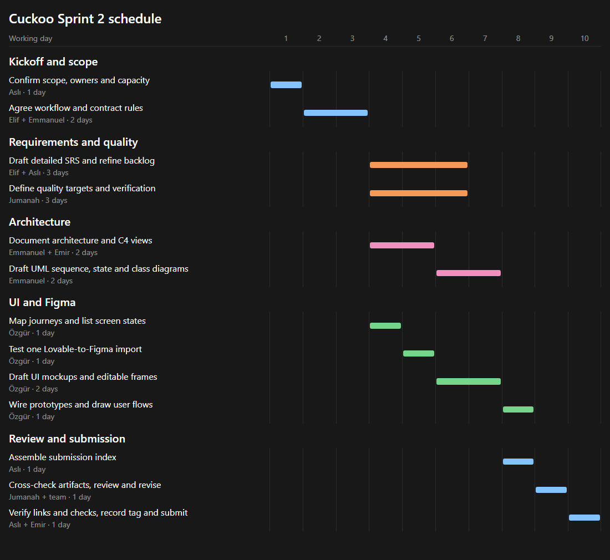

# Cuckoo Sprint 2 planning brief

**SENG 321 · Team 5 · 18 November 2026 · Draft for team agreement**

Sprint 2 will specify and prototype the employer and task-taker journeys for
permitted vehicle photo documentation. The supplied brief asks for a detailed
SRS and refined backlog, measurable quality requirements, Figma prototypes and
user-flow diagrams, and architecture documentation with C4 and UML. The brief
also asks for submission links and release or tag information. The due date,
submission format and any rubric beyond the supplied brief are open.

The assessed [Sprint 1 tag](https://github.com/ozgurfuruncu/SENG-CuckooApp/tree/sprint-1)
points to `39dccc7`. The final documentation sweep merged in
[PR #35](https://github.com/ozgurfuruncu/SENG-CuckooApp/pull/35) at `b3617c1`.
The Sprint 2 handoff branches from that `main` baseline. A merge commit into
`develop` carries forward the reviewed Sprint 1 history and the planning
documents in one PR, combining the sync originally opened in
[PR #36](https://github.com/ozgurfuruncu/SENG-CuckooApp/pull/36) with this handoff.
Sprint 2 design starts from the existing [backlog](product-backlog.md), [issue mapping](issue-index.md),
[OpenAPI draft](../api/openapi.yaml), [Stack A](decisions/ADR-001-architecture.md)
and [MVP boundary](decisions/ADR-002-mvp-boundary.md). The running application
implements health and a web shell. US-01 through US-13 remain planned business
stories, and US-14 and US-15 remain deferred.

## Deliverables and proposed RACI

R means responsible, A accountable, C consulted and I informed. A/R means the
same person owns the outcome and contributes directly. The SRS/backlog,
architecture and sprint evidence rows follow the existing RACI activities. The
quality and prototype rows extend that baseline for Sprint 2. [Team RACI](team-raci.md)

| Deliverable | Elif Nur Akbaş (PO) | Aslı Arıkoğlu (SM) | Emmanuel Alabi (TL) | Jumanah Almodaen (QA) | Emir Dizman (DO) | Özgür Furuncuoğlu (FI) |
| --- | --- | --- | --- | --- | --- | --- |
| Detailed SRS and refined backlog | A/R | R | C | R | I | C |
| Non-functional requirements and quality measures | C | I | R | A/R | R | C |
| Editable Figma design, interactive prototypes and user-flow diagrams | A | I | C | C | I | R |
| Architecture narrative, C4 and UML | C | I | A/R | C | R | R |
| Submission package and review evidence | C | R | R | A | R | R |

### Expected evidence

| Deliverable | What the team should be able to review |
| --- | --- |
| SRS and backlog | A detailed SRS with traceable functional requirements and an updated product backlog with testable acceptance criteria. |
| Non-functional requirements and quality measures | A quality specification with measurable targets and a verification matrix that records which checks are possible in the prototype and which need the running feature. |
| Figma design and user flows | Editable Turkish frames, separate employer and task-taker prototype starting points, and annotated Turkish diagrams for the main journeys and recovery paths. Link applicable story IDs to frames and verify reviewer access. |
| Architecture | Reuse the Sprint 1 boundary diagram for C4 system context if it meets the rubric. Add a C4 container view for the React web client, FastAPI application and PostgreSQL, plus a proposed API component view for the five approved module boundaries. Add UML sequence for assignment through completion, a UML state machine for task and simulated-payment transitions, and a compact UML domain class diagram. Label the current health slice and the proposed business design in each applicable view. [C4 diagram guide](https://c4model.com/diagrams) |
| Submission | One index with Team 5, repository link, the six named responsibilities, issue and PR links, SRS/backlog and quality-spec links, architecture and diagram links, Figma file and flow links, teammate review and CI evidence, and final release or tag information. Aslı assembles it, Jumanah verifies the evidence and Emir records the final tag and commit if the team uses a tag. |

### Deliverable 1 · Detailed SRS and refined backlog

**Produce a versioned SRS and refine the existing [product backlog](product-backlog.md).**
Elif owns their agreement. Aslı coordinates story refinement, Jumanah checks
that the criteria are testable, and Emmanuel reviews OpenAPI alignment.

The **SRS** should describe the product scope, stakeholders and actors, what
each role can do, and the rules and data that determine what happens next.
For each in-scope workflow, document the inputs and outputs, preconditions,
normal path, validation and failure paths, role and ownership rules, and
state transitions. Give each functional requirement a stable ID. Link it to
the existing story, applicable OpenAPI operation, design frame or diagram,
and verification case. Reference the quality specification by its NFR IDs.
Record unresolved decisions with their owners and the requirements they affect.

The **refined backlog** translates the requirements into work the team can
prioritize and estimate. Preserve the existing US-01 through US-15 story IDs
and issue links. Review priorities, estimates and dependencies, keep US-14
and US-15 marked deferred, and add specific acceptance criteria for the
in-scope stories. Identify which conditions are covered by each story and
which decisions are still needed before implementation.

For example, the SRS defines how an employer creates a permitted vehicle-photo
task and which fields are required. The US-03 backlog entry links that
requirement to `createTask` and gives observable acceptance criteria. An
eligible employer supplying valid fields creates an `OPEN` task. A missing
permission acknowledgement is rejected and creates no task. [US-03 specification example](specs/US-03-create-task.md)

### Deliverable 2 · Non-functional requirements and quality measures

**Produce a quality specification with a verification matrix.** Jumanah owns
the artifact and feasibility review with Emmanuel and Emir. Review Sprint 1
decisions for quality constraints, then turn them into measurable targets.
Agreement on private evidence, for example, supplies the rule. The quality
spec defines who to test, what outcome counts as passing, and where the result
will be recorded.

For every quality requirement, record an NFR ID, rationale, affected stories
or components, owner, measurable target, test scenario or workload,
verification method and stage, and evidence status or link. Keep the target
and the observed result in separate fields. The course brief asks for the
specification. A runtime result requires the corresponding implemented feature.

| Quality area | Example target or pass criterion for team review | Verification evidence |
| --- | --- | --- |
| Evidence privacy | Zero successful private-evidence reads in the unrelated-user scenarios. The task owner and assigned task taker can see permitted evidence. | Role and ownership matrix with expected outcomes. Walk through the Figma states in Sprint 2 and verify actual access rules with API tests after implementation. |
| State integrity | Two competing assignment requests for one open task result in one assignment, one conflict and zero partial writes by the losing request. | PostgreSQL integration-test design now and a test result when assignment is implemented. |
| Accessibility | Normal-size text meets the proposed 4.5:1 contrast target. Forms show visible labels and understandable errors. | Record contrast readings and screen references from Figma. Verify keyboard navigation, focus and accessible names in the running web UI. [WCAG 2.2](https://www.w3.org/TR/WCAG22/) |
| Usability | Both Turkish prototype walkthroughs reach the expected completion or recovery state with clear next actions. | Log each step, expected outcome, observed issue and follow-up. Include employer review and task-taker revision. |
| Performance | Illustrative target of p95 at or below 500 ms for `listTasks` with 1,000 synthetic tasks and 20 concurrent users over a 60-second measurement window in a named environment. | Record dataset, environment and measurement method now. Record the observed p95 after the endpoint is available and the run is performed. |
| Reliability | Health reports `503` when the database is unavailable and the response matches the draft contract. | Link the existing health test and the relevant recorded run. [Backend tests](../backend/tests/test_api.py) |

## Prototype scope and handoff

[Original Cuckoo storyboard](https://github.com/ozgurfuruncu/SENG-CuckooApp/blob/76956d71e7eb13d95ef2c5aee558fbd17042b197/docs/diagrams/sprint-2-cuckoo-mockup.jpg) ·
[Current Figma evidence](../prototypes/sprint-2/README.md)

Özgür builds and iterates on the clickable UI in Lovable, then brings the
approved screens into Figma. Turkish is the first product language. Use it
for screen copy, navigation, forms, status and error messages, sample text,
and the Figma prototype and user-flow annotations. Keep draft API identifiers
and story IDs stable. The storyboard supplies the visual direction.

| Journey | Proposed coverage |
| --- | --- |
| Employer | Sign in, post a permitted vehicle-photo-check task, review applicants, select one, record a simulated hold, review evidence, request a revision or approve. Approval completes the task and records a simulated release in the same step. Show cancellation in eligible states and participant history. US-01, US-03, US-06/07, US-09–13. |
| Task taker | Sign in, set self-declared operating city and optional occupation/skills, browse and filter open tasks, apply, see assignment and hold status, submit private photo evidence and notes, then revise if requested. Show participant history and representative empty, validation, and unavailable-action states. US-01/02, US-04/05, US-08/09, US-12/13. |

Annotate the city requirement before applying and the simulated hold before
evidence submission. Treat US-13 privacy as a constraint on both journeys,
including frames that show evidence or task history.

1. Agree on story IDs, screen states and shared copy before generating screens.
   Use a standalone Lovable project with fictional fixtures and local interaction
   state. Keep accounts, photo selection and payment actions simulated, with
   zero backend integrations or network calls for those flows. Use placeholder
   photos and clearly label self-declared attributes and simulated payment.
   Keep the Lovable project separate from the application repository.
2. Generate one representative screen first, such as employer evidence review,
   with realistic mock content at desktop and mobile widths. Test the
   html.to.design browser extension's Capture Preview workflow and import one
   frame as editable layers. Check text, fonts, layout, component cleanup and
   device widths before spending credits on the rest of the screen set. If the
   import adds too much rework, rebuild the core frames directly in Figma.
   [Lovable-to-Figma import guide](https://html.to.design/docs/from-lovable-to-figma)
3. Capture the approved screen states in batches. In Figma, consolidate shared
   components and styles, wire interactions, set the two starting points,
   draw the user-flow diagrams and link the finished file and prototype flows
   from the submission index. [Figma prototype flows](https://help.figma.com/hc/en-us/articles/360039823894-Create-and-manage-prototype-flows)

If the team wants to continue from the generated frontend, it can review and
retain a runnable snapshot in a separate prototype directory in the repository.
Keep its mock data and local run instructions with it. This is an optional
handoff for continued development. The editable Figma prototype and user-flow
diagrams are the required Sprint 2 design deliverables. Later integration with
the application frontend and live API follows the reviewed story workflow.

## Sequence and decisions to record

1. **Agree scope and owners.** Aslı records capacity, owners, reviewers and
   the course deadline in the [sprint decision record](templates/02-sprint-decision-log.md).
   Elif confirms story coverage and the requirements and prototype scope.
   Agree the release/tag convention before assembling the submission. The proposed
   submission tag is `sprint-2` on the final reviewed commit after required
   checks, subject to the course brief and team agreement.
2. **Settle rules that affect multiple artifacts.** Elif, Emmanuel and Jumanah
   review evidence download and participant access, media constraints and
   retention, how photo permission is recorded, request-revision conditions,
   discovery defaults and history visibility. Use the current draft to start
   the design and mark undecided behavior in the SRS, figures and frame notes.
   Reconcile any agreed changes in the linked acceptance criteria and OpenAPI
   through review. [Open contract questions](contract-reconciliation.md)
3. **Draft in parallel once the journeys agree.** Elif and Aslı refine the
   SRS/backlog with Jumanah. Jumanah specifies quality scenarios with Emmanuel
   and Emir. Emmanuel leads the architecture package with Emir and Özgür.
   Emir maps runtime and deployment dependencies, and Özgür maps the web/API
   boundary. Özgür also owns the capture trial and Figma handoff, with Elif
   accepting the two journeys and Jumanah verifying edge-state coverage and
   reviewer access.
4. **Review and assemble.** Cross-check SRS and backlog IDs against the OpenAPI
   draft, diagrams, frames and verification scenarios. Record real teammate
   review, applicable checks and final links in the submission index. Use the
   [canonical SDD workflow](templates/SDD_WORKFLOW.md) and
   [traceability template](templates/10-requirements-traceability.md). Business
   implementation can begin through separate stories once their Ready gates
   are met and the team authorizes that work.
