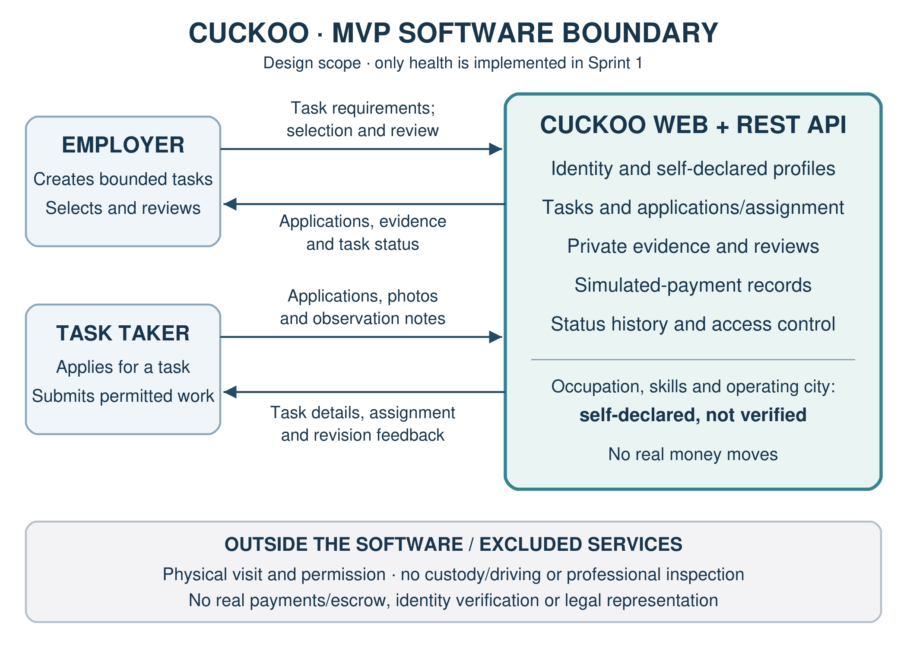

# Cuckoo — Sprint 1 Project Foundation

| Item | Detail |
| --- | --- |
| Course | SENG 321 — Software Engineering Project |
| Team | Team 5 |
| Project | Cuckoo |
| Submission date | 5 November 2026 |
| Repository | [ozgurfuruncu/SENG-CuckooApp](https://github.com/ozgurfuruncu/SENG-CuckooApp) |
| License | [MIT](../../LICENSE) |
| Assessed sprint tag | [sprint-1](https://github.com/ozgurfuruncu/SENG-CuckooApp/tree/sprint-1) |
| Assessed commit | `39dccc709d518a2124f4b5a52d36138a84f3856b` |

> **Sprint 1 closeout completed — 3 November 2026.** The final submission
> correction was independently approved and merged, all five checks passed on
> the assessed main commit, and the annotated `sprint-1` tag was published and
> verified. The [closeout receipt](https://github.com/ozgurfuruncu/SENG-CuckooApp/issues/20)
> records the evidence. This updated narrative records that completed closeout;
> the published tag remains the immutable assessed baseline.

## 1. Project proposal and problem definition

Cuckoo is a web platform for coordinating a bounded task in another city. An
employer describes the requested outcome, local task takers apply, the employer
selects one applicant, and the selected person submits evidence for review. The
platform keeps task ownership, decisions and progress in one traceable workflow.

The first release focuses on **permitted vehicle photographic documentation**.
For example, an employer in Ağrı wants exterior photographs and visible-condition
notes for a vehicle in Ankara. A willing local person performs the agreed visit
with permission from the owner or location controller. Cuckoo coordinates the
information and evidence; it does not inspect, purchase, drive or take custody of
the vehicle.

### Problem statement

Remote requesters lack a simple, traceable way to assign a small,
location-specific task to a willing local person and review structured evidence
of the reported outcome.

Current alternatives can involve personal travel, acquaintances, social groups
and fragmented messages. These arrangements can make responsibilities,
deliverables and decisions difficult to follow. These are the proposal's problem
hypotheses; no interview findings, measured frequency or market-size figures are
claimed. On 3 November 2026, the author confirmed that informal observations
support this problem statement. This is qualitative motivation reported by the
author; no structured observation log or measured frequency/consequences was
supplied for independent verification. The precise process and impact remain
subject to the validation actions in section 7.

### Intended value

- Employers can specify the task, select an applicant and review agreed evidence.
- Task takers can understand the location, permitted activity and expected deliverables before applying.
- Both parties can follow recorded assignment, evidence, review and outcome states.
- The team can demonstrate a coherent API-first workflow within a bounded project scope.

## 2. Stakeholders and users

| Stakeholder | Responsibility | Main concern |
| --- | --- | --- |
| Employer | Creates a task, selects an applicant and reviews evidence | Clear deliverables, control over assignment and private evidence |
| Task taker | Declares an operating city, applies and submits permitted evidence | Clear instructions, permission, bounded activity and visible progress |
| Vehicle owner or location controller | Grants real-world access and photographic permission | Control over property access and photographs |
| Team | Maintain and assess requirements, design and delivery evidence | Explainable decisions, traceability, quality and individual responsibility |

Operating city, occupation and skills are **self-declared**. They are not verified
identity, qualifications or evidence of professional competence.

## 3. System vision

For people who need a bounded task performed in another city, Cuckoo provides a
web workflow connecting remote requesters with willing local task takers,
coordinating assignment, collecting task-specific evidence and recording review
and completion. The system makes responsibilities and state changes traceable
without guaranteeing the correctness of real-world observations.

The intended MVP quality outcomes are:

| Outcome | Acceptance approach for later implementation |
| --- | --- |
| A coherent listing-to-completion journey | End-to-end scenario covering applications, selection, evidence, review and simulated release |
| Exactly one selected worker per task | Transaction/integration test for concurrent assignment |
| Private task evidence | Ownership and unauthorized-access tests |
| Valid lifecycle transitions | Positive, invalid-state and repeated-action tests |
| Persistent application data | PostgreSQL and container-recreation checks |
| Reproducible startup | Docker Compose readiness and health verification |

These describe the planned MVP. Sprint 1 delivers its foundation and contract;
it does not claim that the complete business journey is implemented.

## 4. First-release scope

| Included in the MVP design | Explicitly outside the MVP |
| --- | --- |
| Employer/task-taker registration and role-based access | Institutional identity or professional-credential verification |
| Operating city and optional occupation/skill descriptions | Claims that self-declared attributes establish competence |
| Creation and city/category discovery of vehicle-photo-check tasks | Dog walking, gardening or additional marketplace categories |
| Applications and selection of one applicant | Vehicle driving, custody, purchase execution or legal representation |
| Private photographic evidence and observation notes | Professional mechanical inspection or guaranteed evidence accuracy |
| Employer approval or revision request | Real payments, escrow, real fund custody or financial guarantees |
| Status history and policy-bounded cancellation | Full messaging, ratings and skill recommendations in the core MVP |
| Simulated payment hold/release records | Native mobile application and GPS verification |

An eligible task describes one bounded outcome at a known location, requires
permitted photographic evidence and does not require regulated judgment or
custody of valuable property. Permission is obtained in the real world; the
platform does not grant it.

## 5. Primary user journey

1. An employer creates a `VEHICLE_PHOTO_CHECK` task with a city, instructions, illustrative compensation, evidence requirements and permission confirmation.
2. A local task taker browses and applies. The employer selects exactly one applicant.
3. The employer records a **simulated** hold. No real funds are collected or transferred.
4. The selected task taker makes the permitted visit and submits photographs and notes.
5. The employer approves the evidence or requests a revision under the agreed state rules.
6. Approval leads to completion and a **simulated** release, with recorded task history.

Unauthorized access, invalid inputs, conflicting assignments, invalid transitions
and repeated terminal actions are part of the contract and later test design.

## 6. System boundary

The diagram's [SVG source](../diagrams/system-context.svg) is maintained with the
project. Its arrows identify the direction and purpose of exchanged information.

| Inside Cuckoo's software responsibility | Outside software responsibility |
| --- | --- |
| Web interface, REST API and access control | Physical travel, visits and real-world permission |
| Task, application and assignment records | Vehicle custody, driving, purchase or specialist inspection |
| Evidence submission, private access and employer review | Verification of identity, competence or observation accuracy |
| Task history and simulated payment records | Real money, escrow, payment disputes and legal agency |
| Relational persistence and containerized deployment | External processes that the MVP does not integrate |

## 7. Feasibility, assumptions and risks

A single supported task category and a modular monolith keep the project
manageable for a six-person team. The selected stack supports a typed client,
explicit API schemas, relational transactions, repeatable migrations and
automated verification without requiring distributed services.

Key assumptions are that participants can describe a bounded task, the selected
person can obtain permission for the visit, and photographs/notes can satisfy
the agreed deliverable. Self-declaration and submitted evidence remain subject to
the stated trust limits.

Feasibility is bounded by the course schedule: Sprint 1 delivers design and a
tested health foundation; the 13 business stories are a later prioritized product
backlog, not a commitment to implement the whole marketplace in one sprint.
Data begins as user-entered task/profile information; no proprietary dataset or
external provider integration is required. The local identity design and simulated
payments avoid relying on unavailable institutional or financial services. The
team's selected stack and named roles support delivery, but no comparative skill
measurement or stakeholder demand estimate has been supplied. Real-world access,
photographic consent and private evidence handling remain operational and ethical
constraints.

| Risk | Response in the project design |
| --- | --- |
| Scope growth | One supported category, explicit deferred items and story-level scope |
| Misleading trust claims | Self-declared labels and clear limits on photographic observations |
| Private evidence exposure | Authenticated access, ownership checks and negative tests |
| Double assignment or invalid state changes | Transactions, constraints and state/concurrency tests |
| Unexplained agent-generated work | Human-owned specifications, teammate review and explainable PRs |
| Uneven or invisible contributions | Named responsibilities and issue/commit/PR/review traceability |

### Planned proposal validation

| Assumption to validate | Planned action and record to produce | Responsible role |
| --- | --- | --- |
| Remote requesters encounter a material coordination problem | Interview a prospective requester and local task taker about a recent case; record consented source, current process, frequency, consequences and contradictory findings | PO, with SM |
| The permitted photographic task is understandable and useful | Walk both actors through one example task and expected evidence; record unclear instructions, permission constraints and whether the outcome would meet the requester’s need | PO and frontend/integration |
| The planned journey is coherent and testable | QA and TL review a request → application → assignment → evidence → revision/approval scenario against the draft API; record gaps before business implementation | QA and TL |
| Private evidence and repeatable startup can be delivered within scope | Agree file/access/retention rules before US-08; maintain actual health, migration, contract and isolated Compose test results | TL, QA and DevOps |

The PO owns follow-up validation of these informal observations.

## 8. License decision

Cuckoo uses the **MIT License** for original project code. The team selected a
concise permissive license that allows reuse, modification and redistribution
subject to its notice requirements. The complete [LICENSE](../../LICENSE) and
original attribution are retained in the repository. Third-party licenses remain
separate from the license applied to the team's own work.

MIT permits commercial use and does not require derivatives to retain the same
license; it does require preservation of its notice. It has no express patent
grant comparable to Apache-2.0. Existing third-party notices must be retained;
the project license does not relicense dependencies. No comprehensive legal
compatibility opinion is asserted by this academic proposal.

## 9. Architecture and approved technology

[ADR-001](../decisions/ADR-001-architecture.md) records the accepted Stack A.
The system is an API-first modular monolith with five boundaries:
identity/profile, tasks, applications/assignment, evidence/reviews and
simulated-payment. [ADR-002](../decisions/ADR-002-mvp-boundary.md) records the MVP boundary.

| Layer | Technology | Purpose |
| --- | --- | --- |
| Frontend | React, TypeScript, Vite | Typed web interface and API integration |
| Backend | FastAPI, Pydantic | HTTP operations, validation and response schemas |
| Persistence | PostgreSQL, SQLAlchemy, Alembic | Relational data, transaction rules and migrations |
| Backend tests | pytest | Unit, API, negative and integration checks |
| Local deployment | Docker Compose | Consistent startup and service readiness |
| Continuous integration | GitHub Actions | Contract, backend, frontend and Compose checks |

The Sprint 1 application implements database-aware health and a TypeScript web
shell. Business operations in the OpenAPI draft are the design baseline for later
reviewed stories.

## 10. Team responsibilities and RACI

| Role | Owner | GitHub account |
| --- | --- | --- |
| Product Owner / Requirements Engineer | Elif Nur Akbaş | `elfn0909` |
| Scrum Master / Agile Process Coach | Aslı Arıkoğlu | `asliarikoglu` |
| Lead Software Architect / Technical Lead | Emmanuel Alabi | `anyx05` |
| QA and Test Automation Engineer | Jumanah Almodaen | `j7766n` |
| DevOps / CI-CD Infrastructure Engineer | Emir Dizman | `lilemiv` |
| Frontend and Integration Engineer | Özgür Furuncuoğlu | `ozgurfuruncu` |

R = Responsible, A = Accountable, C = Consulted, I = Informed. Each activity has
one accountable owner. FI is the team's supporting frontend/integration role.

| Activity | PO | SM | TL | QA | DO | FI |
| --- | --- | --- | --- | --- | --- | --- |
| Confirm scope and eligibility | A | R | C | C | I | C |
| Vision and stakeholder understanding | A | R | C | C | I | I |
| System boundary diagram | C | I | A | C | R | R |
| Draft OpenAPI contract | C | I | A | R | C | R |
| Backlog and acceptance criteria | A | R | C | R | I | C |
| GitHub workflow and issue organization | I | A | C | C | R | R |
| Sprint evidence and review | C | R | R | A | R | R |

## 11. Repository and lightweight Git-Flow policy

- `main` holds assessed versions; [sprint-1](https://github.com/ozgurfuruncu/SENG-CuckooApp/tree/sprint-1) identifies the reviewed and tested Sprint 1 baseline at `39dccc7`.
- `develop` integrates work for the next delivery.
- `feature/<issue>-<description>` is a short-lived branch linked to an existing story or technical issue.
- PRs identify the issue, scope, assumptions and relevant test/review evidence.
- At least one teammate reviews correctness, clarity, tests and API impact.
- `main` and `develop` use PR and status-check protection, as the supplied course pack requires.
- Contributors use individual accounts and preserve shared history and published tags.

## 12. Specification-driven agile development

The canonical process is:

**Approved story → Feature specification → OpenAPI review → Test design →
Agent-assisted implementation → Human review → CI → Merge → Traceability update.**

The [SDD workflow](../templates/SDD_WORKFLOW.md) supplies reusable role templates,
Definition of Ready and Definition of Done. Ready work has a clear actor/value,
testable acceptance criteria, known dependencies/API impact and an achievable
sprint-sized scope. Done work demonstrates those criteria, relevant tests,
teammate review, passing applicable CI and updated traceability.

Every behavior change requires tests. Authorization and state-transition changes
include negative tests. Contract disagreements are reconciled before coding.
Agents assist with bounded work; humans own requirements, architecture,
understanding and acceptance.

The [US-03 specification example](../specs/US-03-create-task.md) demonstrates
contract-linked acceptance criteria and test design. It is a documentation
example for future implementation. The [traceability template](../templates/10-requirements-traceability.md)
connects requirements to operations, tests, PRs, reviews and assessed revisions.

## 13. Initial product backlog

The backlog groups existing stories into four MVP epics:

| Epic | Capability | Stories |
| --- | --- | --- |
| E-01 | Identity and self-declared profile | US-01, US-02 |
| E-02 | Bounded tasks, discovery and cancellation | US-03, US-04, US-11 |
| E-03 | Applications, assignment and simulated hold | US-05, US-06, US-07 |
| E-04 | Private evidence, review, completion and history | US-08, US-09, US-10, US-12, US-13 |

Elif Nur Akbaş (`elfn0909`) is the planning/acceptance owner for all stories below.
Implementation assignees are agreed during sprint planning.

| Story / issue | Priority | Points | Acceptance evidence | Dependencies |
| --- | --- | ---: | --- | --- |
| [US-01 — Register/sign in](https://github.com/ozgurfuruncu/SENG-CuckooApp/issues/1) | P0 | 5 | Valid login; forbidden actor rejected | — |
| [US-02 — Self-declared profile](https://github.com/ozgurfuruncu/SENG-CuckooApp/issues/2) | P0 | 3 | Optional fields; self-declared label | US-01 |
| [US-03 — Create bounded task](https://github.com/ozgurfuruncu/SENG-CuckooApp/issues/3) | P0 | 5 | Required fields; unauthorized create rejected | US-01 |
| [US-04 — Browse/filter tasks](https://github.com/ozgurfuruncu/SENG-CuckooApp/issues/4) | P0 | 3 | City/category filters; valid empty result | US-03 |
| [US-05 — Apply](https://github.com/ozgurfuruncu/SENG-CuckooApp/issues/5) | P0 | 3 | One application per worker/task; no self-apply | US-03 |
| [US-06 — Select applicant](https://github.com/ozgurfuruncu/SENG-CuckooApp/issues/6) | P0 | 5 | Exactly one selection; authorization/concurrency cases | US-05 |
| [US-07 — Simulated hold](https://github.com/ozgurfuruncu/SENG-CuckooApp/issues/7) | P0 | 3 | Authorized valid-state hold; no real funds | US-06 |
| [US-08 — Submit evidence](https://github.com/ozgurfuruncu/SENG-CuckooApp/issues/8) | P0 | 5 | File/note rules and private access | US-06, US-07 |
| [US-09 — Review/revision](https://github.com/ozgurfuruncu/SENG-CuckooApp/issues/9) | P0 | 5 | Owner-only review; invalid transitions rejected | US-08 |
| [US-10 — Complete/simulated release](https://github.com/ozgurfuruncu/SENG-CuckooApp/issues/10) | P0 | 3 | Hold, evidence and approval required | US-07, US-09 |
| [US-11 — Cancel eligible task](https://github.com/ozgurfuruncu/SENG-CuckooApp/issues/11) | P1 | 3 | Allowed states; duplicate terminal action rejected | US-03 |
| [US-12 — View history](https://github.com/ozgurfuruncu/SENG-CuckooApp/issues/12) | P1 | 3 | Relevant workflow actions visible to participants | US-06 |
| [US-13 — Private-data controls](https://github.com/ozgurfuruncu/SENG-CuckooApp/issues/13) | P1 | 5 | Authorization, evidence and file rejection cases | US-01, US-08 |

US-14 ratings and US-15 skill-informed suggestions remain **deferred, outside the
MVP**. The [full backlog](../product-backlog.md) preserves their original estimates,
dependencies and issue references without authorizing implementation.

## 14. Draft API contract

[api/openapi.yaml](../../api/openapi.yaml) is the canonical OpenAPI 3.1 design
baseline. It contains 17 operations covering health, registration/login, profile,
tasks, applications, assignment, simulated hold, evidence, review, cancellation
and history. Reusable schemas and security definitions describe inputs,
responses and representative validation, authorization, not-found and conflict
behavior.

The primary creation operation is `POST /api/v1/tasks` (`createTask`), using
`NewTask` and `Task`. It permits `EMPLOYER` creation of `VEHICLE_PHOTO_CHECK` tasks
and specifies 201/400/401/403 responses. Assignment and other lifecycle operations
include conflict responses where their contract requires them. Contract changes
are versioned and reviewed before implementation.

[Representative API examples](../api-examples.md) show a complete task-creation
request, success response, input-error body and assignment-conflict body, checked
against the draft schemas. They support mock clients and do not claim deployed
business endpoints or introduce new response guarantees.

## 15. Sprint 1 deliverables

| Deliverable | Submission artifact |
| --- | --- |
| Proposal, problem, stakeholders, feasibility and scope | Sections 1–7 of this submission |
| Open-source license | Section 8 and [LICENSE](../../LICENSE) |
| System vision and boundary | Sections 3/6 and [labelled diagram](../diagrams/system-context.svg) |
| Architecture and API-first design | Section 9, [ADR-001](../decisions/ADR-001-architecture.md) and [OpenAPI](../../api/openapi.yaml) |
| Named responsibilities and RACI | Section 10 and [team role record](../team-raci.md) |
| Repository workflow and assessed tag | Section 11, [sprint-1](https://github.com/ozgurfuruncu/SENG-CuckooApp/tree/sprint-1) and the [verified evidence index](README.md) |
| Initial prioritized backlog | Section 13 and [issue mapping](../issue-index.md) |
| SDD process and example | Section 12 and [US-03 specification](../specs/US-03-create-task.md) |

The final closeout is supported by:

- [PR #34](https://github.com/ozgurfuruncu/SENG-CuckooApp/pull/34), merged into the assessed main commit.
- [Independent approval by anyx05](https://github.com/ozgurfuruncu/SENG-CuckooApp/pull/34#pullrequestreview-5751704339) on the final PR head before merge.
- [Main CI run 41630981575](https://github.com/ozgurfuruncu/SENG-CuckooApp/actions/runs/41630981575), with all five required checks successful at `39dccc7`.
- [Published sprint-1 snapshot](https://github.com/ozgurfuruncu/SENG-CuckooApp/tree/sprint-1) and the [closed closeout issue](https://github.com/ozgurfuruncu/SENG-CuckooApp/issues/20).

This submission describes the completed Sprint 1 project foundation and the
planned MVP. Planned business features and proposal follow-up actions remain
future work; repository closeout does not assert instructor acceptance.
