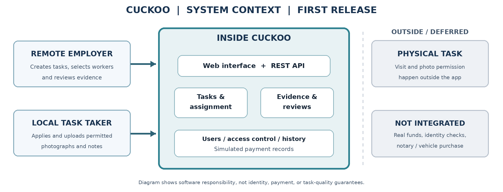

# Sprint 1 submission and repository evidence ledger

The [supplied Word document](Cuckoo_Sprint1_Submission.docx) is preserved without
modification. SHA-256:
`04C3B14CFA8DA58B6A0C06BF98A01B5EADE8EF82BB6BDBC3A3ED2B931F012E86`.
Its supplied submission date is **5 November 2026**. It confirms Stack A,
SQLAlchemy/Alembic/pytest, six named roles, RACI, MIT and the bounded MVP. General
team experience remains self-reported intermediate; no measured proficiency,
stakeholder interviews or peer approvals are inferred.

This source supersedes the old proposal/addendum's placeholders and unselected-stack
language. The original document's pending evidence cells remain untouched; use
this ledger to transfer verified links into the final submitted copy after review.

| Evidence | Link/location | Current interpretation |
| --- | --- | --- |
| Repository | [SENG-CuckooApp](https://github.com/ozgurfuruncu/SENG-CuckooApp) | Verified existing public repository |
| Foundation integration PR | [#17](https://github.com/ozgurfuruncu/SENG-CuckooApp/pull/17) | Open draft; green foundation CI; no human approval at last inspection |
| Bootstrap issue | [#18](https://github.com/ozgurfuruncu/SENG-CuckooApp/issues/18) | Separate bounded post-approval work; technical owner from supplied roles, no guessed account assignment |
| Backlog | [Issue index](../issue-index.md) | US-01..15 published; US-14/15 deferred; individual GitHub assignees still pending |
| Canonical contract | [api/openapi.yaml](../../api/openapi.yaml) | OpenAPI 3.1, version 0.2.1-draft; bootstrap health slice added |
| Existing verified CI | [Foundation backend](https://github.com/ozgurfuruncu/SENG-CuckooApp/actions/runs/41349590906), [foundation contract](https://github.com/ozgurfuruncu/SENG-CuckooApp/actions/runs/41349590909) | Passed for foundation commit 5478308; bootstrap results recorded separately |
| MIT and architecture | [LICENSE](../../LICENSE), [accepted ADR-001](../decisions/ADR-001-architecture.md) | Original MIT attribution retained; selection approved by user on 2026-11-02; peer review pending |
| System context | [Diagram](../diagrams/system-context.png) | Exact image2.png extracted from supplied Word document; no generated replacement |
| Roles/RACI and submission | [RACI](../team-raci.md), [DOCX](Cuckoo_Sprint1_Submission.docx) | Supplied six named roles and exactly one accountable owner per activity |
| Bootstrap PR / CI | [Draft #19](https://github.com/ozgurfuruncu/SENG-CuckooApp/pull/19), [CI](https://github.com/ozgurfuruncu/SENG-CuckooApp/actions/runs/41352615487), [full evidence](../stack-a-bootstrap-evidence.md) | Implementation commit d1810c2 passed backend/PostgreSQL, frontend, Compose and contract checks; 16 pytest tests, 96.32% CI coverage; human review pending |
| Branch rules / collaborators / Project | Pending administrator/account evidence | Current account has no repository admin/maintain; prior Projects scope rejection remains unresolved |
| Sprint 1 tag/release | Pending reviewed integration | No tag or release created; do not insert a fabricated release URL |

The diagram describes product responsibility, not implementation completeness or
identity, payment or physical-task guarantees. Business routes are not implemented
by the health-only bootstrap. Peer review, repository rules, confirmed owners and
reviewed integration still precede Sprint 1 tagging.
